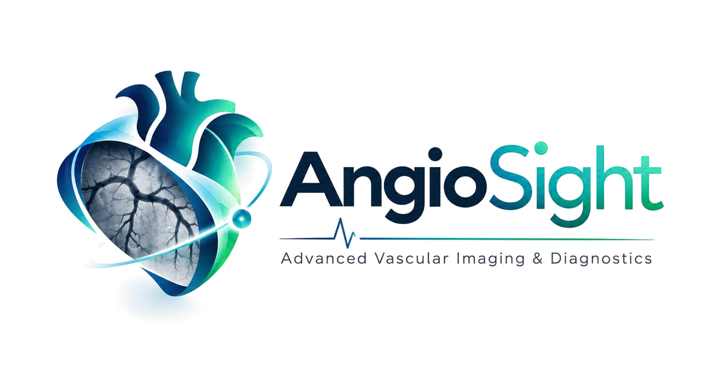
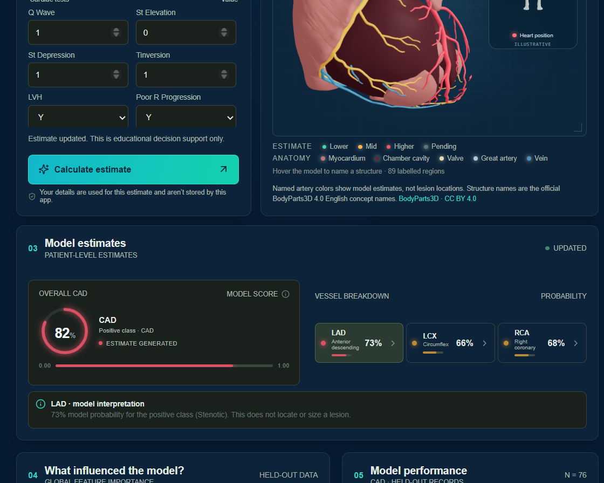
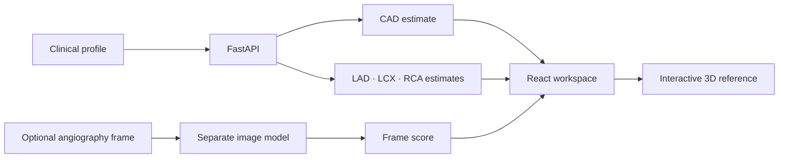

<p align="center">
  
</p>

<h1 align="center">AngioSight</h1>

<p align="center">
  <strong>Clinical features in. Research estimates out. Heart anatomy in view.</strong><br>
  An interactive cardiovascular research prototype built to make model outputs easier to inspect—and their limits harder to miss.
</p>

<p align="center">
  <a href="https://github.com/Jack-ksrct/AngioSight3D/actions/workflows/ci.yml"></a>
  
  
  
</p>

<p align="center">
  <a href="#get-started">Get started</a> ·
  <a href="#inside-the-workspace">Explore the workspace</a> ·
  <a href="#model-performance">Model performance</a> ·
  <a href="docs/demo-script.md">Demo walkthrough</a>
</p>

<p align="center">
  
</p>

> [!CAUTION]
> **Research and education only. Not a medical device.** Do not use AngioSight for diagnosis, treatment, triage, emergency decisions, or patient care. Its estimates do not replace clinical assessment or diagnostic imaging. The bundled clinical model was developed from 303 records and has not been clinically validated. Never enter identifiable patient information.

## The idea

AngioSight brings three things into one review flow: a structured cardiovascular profile, dataset-derived estimates, and an interactive anatomical reference. It is designed for transparent exploration—not to turn a probability into a diagnosis.

### Inside the workspace

| 🧾 Clinical profile | 📊 Research estimates | 🫀 Anatomy reference |
|---|---|---|
| 54 inputs across profile, history, vitals, symptoms, labs, and cardiac tests. Search fields and leave unknown values blank. | CAD plus LAD, LCX, and RCA outputs, with model context and input-sensitivity comparisons. | Rotate and zoom the 3D heart. The assessment reference gives coronary vessels an aggregate estimate color after a prediction. |

### Also included

- **Optional angiography scoring:** a separate frame-level research model. Its score is not blended into the clinical estimate.
- **Honest model context:** held-out metrics, class balance, feature sensitivity, and documented limitations.
- **A responsive interface:** light and dark themes, touch rotation, and layouts for narrow screens.
- **A privacy-minded prototype:** submitted inputs and images are processed in memory; the app does not save assessment history.

## How the pieces connect



The angiography branch stays separate because an uploaded frame is not verified as belonging to the person represented by the clinical inputs. The 3D heart is generic reference anatomy; estimate colors do **not** locate a patient-specific lesion.

## Model performance

The numbers below describe the currently saved evaluation snapshot: 76 held-out records from a stratified 25% split, seed 42. They are development results, **not clinical validation**. The training command now reports stratified out-of-fold estimates and refits the saved models on all labeled records; rerun it to replace the older metrics artifact.

| Output | Accuracy | Precision | Recall | F1 | ROC-AUC |
|---|---:|---:|---:|---:|---:|
| CAD | **84.2%** | 88.9% | 88.9% | 88.9% | 87.9% |
| LAD stenosis | 80.3% | 79.6% | 88.6% | 83.9% | 83.9% |
| LCX stenosis | 60.5% | 50.0% | 56.7% | 53.1% | 69.4% |
| RCA stenosis | 67.1% | 56.7% | 58.6% | 57.6% | 75.0% |

**LCX is a known weak point:** its accuracy is around the majority-class baseline, so the current model does not provide useful LCX discrimination. RCA is only slightly above its baseline. Scores are uncalibrated and depend on a small dataset; do not interpret them as an individual’s clinical risk.

The optional CADICA angiography branch also needs substantial improvement. In patient-grouped evaluation it reaches approximately **0.53 frame ROC-AUC** and **0.50 balanced accuracy**—near chance. At the current 0.5 threshold, it predicts every patient positive. Details and methodology: [Imaging model notes](docs/imaging-model.md).

## Get started

### Requirements

- Python 3.12+
- Node.js 24 and pnpm 11.19.0
- A modern browser with WebGL for the 3D viewer
- The authorized training dataset, placed in `data/` (not included in this repository)

Install pnpm if needed:

```sh
npm install --global pnpm@11.19.0
```

### Windows

```powershell
.\scripts\windows\setup.ps1
.\scripts\windows\train-models.ps1   # required before estimates are available
.\scripts\windows\start-api.ps1      # terminal 1 · http://localhost:8000
.\scripts\windows\start-web.ps1      # terminal 2 · http://localhost:5173
```

### macOS / Linux

```sh
bash scripts/unix/setup.sh
bash scripts/unix/train-models.sh      # required before estimates are available
bash scripts/unix/start-api.sh         # terminal 1
bash scripts/unix/start-web.sh         # terminal 2
```

The training pipeline reads the first worksheet of the Z-Alizadeh Sani dataset and also accepts CSV and XLSM files. To run it directly from the repository root:

```sh
python -m backend.train --data "data/extention of Z-Alizadeh sani   dataset.xlsx" --output models
```

Training writes the model bundle and evaluation metrics to `models/`. Inspect `models/metrics.json` before using the API. The dataset and trained bundles are intentionally excluded from Git; follow their licenses and access requirements.

To enable the optional angiography branch, provide an authorized CADICA archive:

```sh
python -m backend.train_angiography --zip path/to/cadica.zip --output models
```

Then run the app in containers:

```sh
docker compose up --build
```

The API container mounts `models/` read-only. API docs are disabled in Docker by default; local development serves them at <http://localhost:8000/docs>.

## Anatomy and attribution

The home page uses a labeled realistic heart reference. The assessment uses **“Cardiac Anatomy: Coronary arteries of the heart”** by [HannahNewey](https://sketchfab.com/HannahNewey), licensed under [CC BY-NC-SA 4.0](https://creativecommons.org/licenses/by-nc-sa/4.0/). Its license is included beside the model files, and the full attribution and modifications are documented in [Anatomy attribution](docs/anatomy-attribution.md).

After an estimate is generated, the assessment applies an aggregate color to the coronary vessel meshes using the mean LAD, LCX, and RCA estimates. The source mesh does not identify each branch separately. These colors are a visual research cue—not lesion localization or patient-specific anatomy.

The project also includes BodyParts3D-derived anatomy resources and naming tools. See [the attribution and build notes](docs/anatomy-attribution.md) for source credits, license terms, and the anatomy-label workflow.

## Project map

```text
backend/       FastAPI service, model training, and API checks
frontend/      React app, 3D viewers, and shipped anatomy assets
scripts/       Setup helpers and anatomy build tools
docs/          Architecture, model card, safety, attribution, and demo guide
data/          Local authorized training data (not committed)
models/        Local trained bundles and metrics (not committed)
```

## Further reading

| Guide | Contents |
|---|---|
| [Architecture & API](docs/architecture.md) | Services, endpoints, and data flow |
| [Dataset contract](docs/data-contract.md) | Inputs, encodings, and imputation |
| [Model card](docs/model-card.md) | Intended use, metrics, and failure modes |
| [Imaging model](docs/imaging-model.md) | CADICA method and evaluation |
| [Safety & privacy](docs/safety-and-privacy.md) | Data handling and deployment boundaries |
| [Anatomy attribution](docs/anatomy-attribution.md) | Model credits, licenses, and anatomy labels |
| [Demo walkthrough](docs/demo-script.md) | A short guided presentation |

## Verification

```powershell
python -m unittest backend.test_api backend.test_imaging -v
cd frontend
pnpm install --frozen-lockfile
pnpm run check:framing
pnpm run build
```

GitHub Actions runs API checks and builds the frontend on pushes and pull requests. It does not deploy the app.

---

<p align="center"><strong>Built for research and education.</strong><br>BodyParts3D, © The Database Center for Life Science, licensed under <a href="https://creativecommons.org/licenses/by/4.0/">CC BY 4.0</a>.</p>
